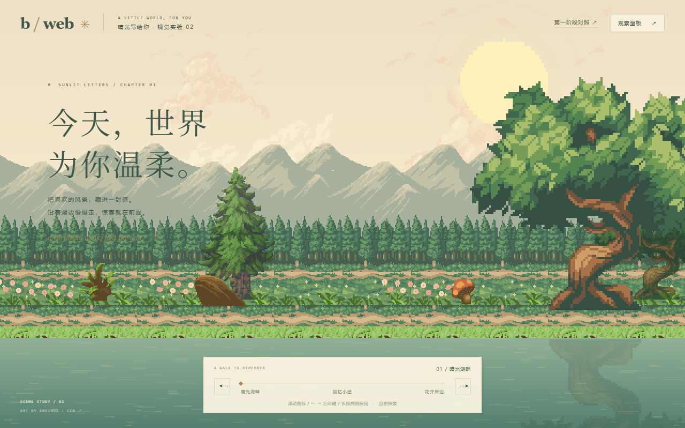
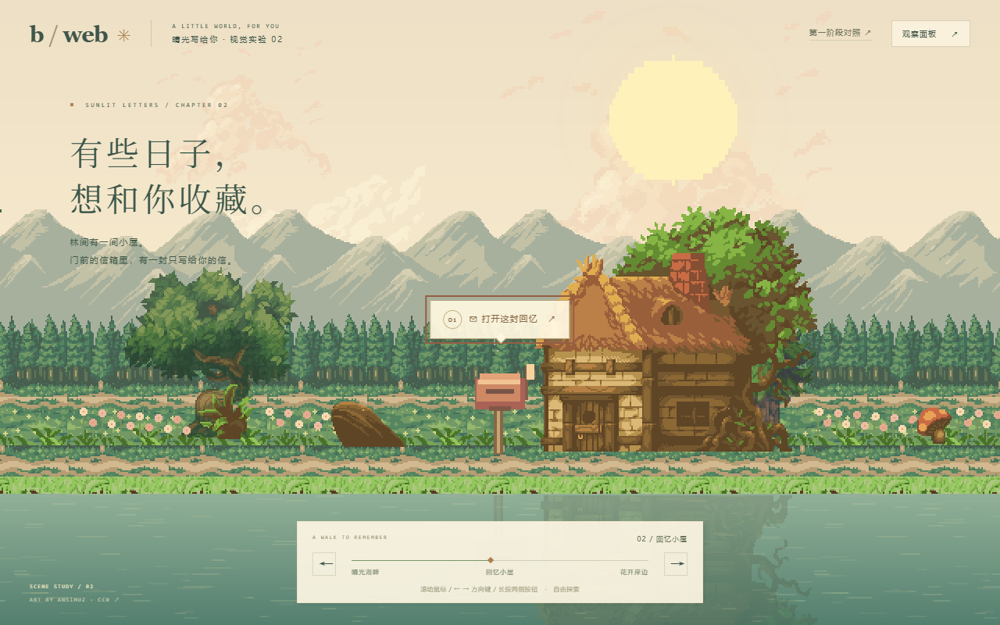
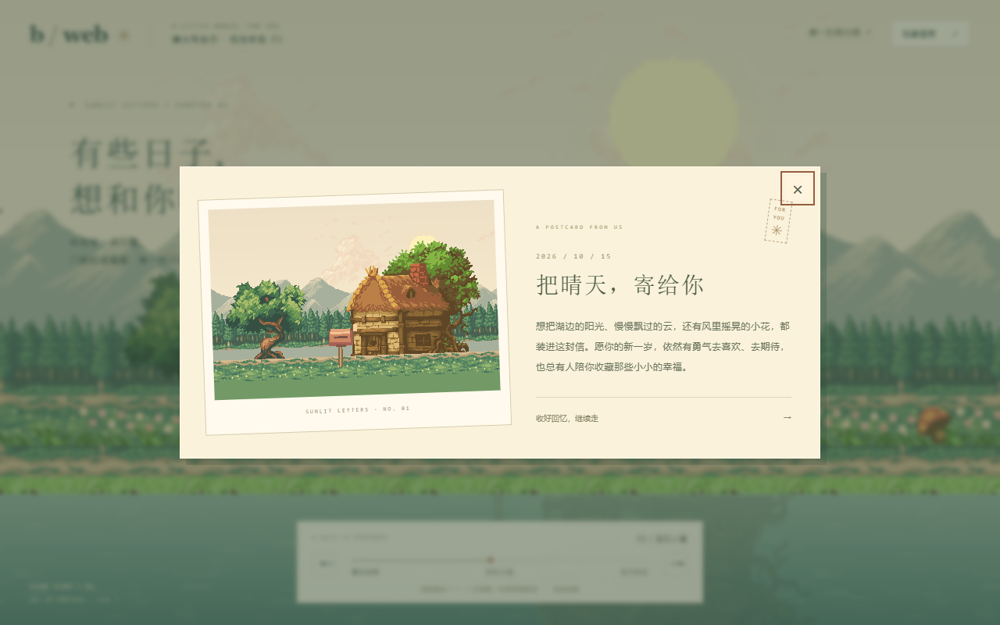
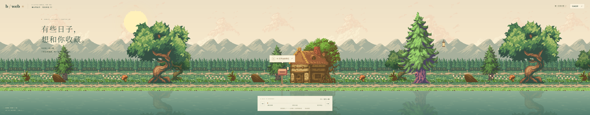

# 第二阶段视觉实验：晴光写给你

日期：2026-10-15。实验分支：`codex/visual-experiment`。基线：`stage-1-technical-validation`（`ec9a42c`），未改变第一阶段分支。

## 设计目标与取舍

把第一阶段的占位景观变为一段有温度的生日散步。主线是“晴光湖畔 → 回忆小屋 → 花开岸边”，长 2048 逻辑像素；在 1280×800、整数 2 倍像素缩放时约 3.2 个视口。

《王国：两位君主》提供的启发是大尺度树冠的前后遮挡、横向岸线、负空间和水面倒影；《火山的女儿》提供的启发是明亮自然色、暖木材和带情感的纸质界面。这里采用这些组织思路，没有使用两款游戏的图像。

美术优先选同一作者的作品。Magical Road 的真实草地和土路、SunnyLand Woods 的像素岩面、Trees Expansion 的完整树冠、SunnyLand Forest 的小屋虽来自不同包，但使用相近的 16 位风格。通过明确的色板替换把它们统一，而非直接混放原色素材。

## 色彩与画面层次

| 层次 | 色彩方向 | 作用 |
| --- | --- | --- |
| 天空 / 云 | 奶油、淡杏、少量柔桃色 | 明亮、温暖；为标题保留低对比背景 |
| 远山 | 灰绿、鼠尾草色 | 降低对比，让空间后退 |
| 中景林地 | 松绿、苔绿、暖沙色 | 提供细密景观和连续地平线 |
| 前景树冠 | 暖绿高光、深森林绿阴影 | 为开场和终点形成视觉框架 |
| 小屋 / 枝干 | 铜棕、蜂蜜木色 | 与绿色互补，形成温暖的叙事中心 |
| 湖水 / UI | 青灰绿倒影、象牙色纸面 | 延伸场景深度，并让界面安静地浮在世界上 |

远山保留真实的像素岩面细节。树冠改成有限的暖绿色阶，原来的紫色枝干改为铜棕色。水面使用离散色阶与低对比水纹，真实树木和小屋的纹理镜像构成倒影。

首轮实测中发现云层太规律、水纹亮度过强，因此重新提取并安排云形疏密，降低水纹对比。最终天空采用较宽的重组纹理，并向下延长纯天空色，避免高屏幕出现重复云带。

## 连续构图

- **开场**：标题在左上低对比天空里，近处大树进入画面右侧，太阳与树冠相邻。小花和土路提示探索方向，湖面留出呼吸空间。
- **小屋**：镜头继续移动后，近处大树离开左缘，小屋与屋顶植被进入中央偏右；门前信箱为唯一交互物件，固定在 `x=980`。标题缩小并更换成收藏回忆的文案。
- **花园**：小屋退出后，较高的松树、纸灯和另一棵大树构成收束。没有添加关卡、角色或额外业务功能。

地面由可平铺的真实草岸块和不规则土路拼接。中景和前景装饰按固定世界坐标独立安排，疏密、遮挡和地标都不依赖整张背景图片横向排列。

## PixiJS 实现

`World` 使用 Assets 异步加载、Sprite、TilingSprite 和少量 Graphics。主体图像来自真实 PNG；Graphics 只用于遮罩、细绳和少量漂浮微光。

五层视差速度：天空 0.06、山脉 0.18、林地 0.42、近林 0.72、前景 1。镜头、输入、事件分发和 Go 服务沿用第一阶段实现。

所有输出纹理采用 nearest 采样；素材不随窗口任意拉伸。远处/普通物件以 1 倍显示，近处树木以整数 2 倍显示，形成距离感。Canvas 再按整数倍率放大；Resize 调整地平线与露出的范围，保留物件世界坐标。装饰 Sprite 在视口外隐藏，倒影共享原有纹理，没有创建巨大世界 RenderTexture。

环境动态包括云层漂移、花草轻摆、灯光呼吸、稀疏微光漂浮和缓慢水纹。没有逐帧创建对象或重绘主体图像。“减少动态效果”模式停止这些动态，但保留探索和卡片交互。

新增 `art.js` 只负责纹理加载；`scripts/prepare_art.py` 负责离线裁切、改色与组合。11 张原始 PNG 和随包许可证保留，19 张输出纹理连同明信片约 72.2 KB。精确来源、修改内容、像素尺寸与哈希见 [素材来源](asset-sources.md) 和 `frontend/public/art/manifest.json`。

## HTML UI

用纸面、细边框、衬线中文标题、小号章节标记和暖金色菱形进度指示，呼应树林中的木色与阳光。调试面板默认隐藏，日常画面保留标题、探索条和作者署名。

卡片由同一批授权素材拼成风景明信片，取代第一阶段几何占位图；信封式邮票与斜放纸边提供细节。仍使用原生 dialog 的输入隔离、焦点约束、Escape 和关闭后恢复。

手机上减少导航文字，保留可操作按钮、主要标题与信箱提示。信箱提示在靠近边缘时保持完整，其指示角继续指向物件。小屋是景观地标；点击入口位于信箱及 HTML 提示。

## 实际检查与截图

| 检查 | 实际结果 |
| --- | --- |
| `go test ./...`、`go vet ./...`、Go 编译 | 全部通过，生成 `bin/b-web-visual.exe` |
| `npm test` | 5 / 5 通过 |
| `npm run build` | 普通包与验证包均通过 |
| 开发路径浏览器 E2E | 9 / 9 通过，22.8 秒 |
| Gin 生产托管浏览器 E2E | 9 / 9 通过，18.2 秒 |
| `npm run test:production` | 普通生产包 API、真实输入、卡片开关正常；测试快照入口不存在 |
| 应用内浏览器 | 实际检查 1280×800 开场、小屋与卡片；结束后恢复默认视口 |

没有观测到正常路径的控制台 error、未捕获异常或失败素材请求；HTTP 503 用例为故意注入的错误。纹理加载数为 18（卡片图片按需加载），均使用 nearest。桌面与手机快照分别约 57、60 FPS，自动化使用 SwiftShader 软件 WebGL；全景截图只作画幅检查，不作为性能测量。

Pixi 分包为 586.33 KB（gzip 169.61 KB），仍有 Vite 默认的 500 KB 体积提示。没有通过提高阈值隐藏警告；后续引入正式图集和更多事件时再评估按需模块与包体预算。

本地详细机器结果在 `artifacts/visual-e2e-development.json`、`visual-e2e-production.json` 和 `visual-production-smoke.json`；这些生成结果继续被 Git 忽略。

构建与浏览器测试检查真实资源加载、纹理 nearest 采样、镜头和五层投影、环境动画、信箱点击、卡片、API 错误、窗口比例、减少动态效果和第一阶段对照。测试通过真实输入操作；快照仅用于只读检查。

截图位于 `docs/screenshots/`：

- `desktop.png`：1280×800 开场的完整网页。
- `cottage.png`：回忆小屋与提示。
- `garden.png`：终点花园。
- `memory.png`：桌面明信片浮层。
- `mobile.png` / `memory-mobile.png`：390×844 的场景裁切与卡片。
- `panorama.png`：4096×800 浏览器画幅中完整世界的实际截图，不是拼接或概念效果图。

## 客观不足与下一步

1. 远山和小树仍可识别出平铺节奏。后续正式美术应提供更长的背景带或更多轮廓变化。
2. 四个同作者素材包的像素笔触仍有差别；近树 2 倍、房屋 1 倍的颗粒大小也不同。当前是明确的距离处理，尚未达到统一定制美术的完成度。
3. 窄屏只显示小屋的一部分，需要横向继续探索才能看见全貌。正式移动端应研究地标自动取景与更适合竖屏的构图。
4. 倒影使用透明纹理镜像与水纹叠加，足以验证氛围，但不是精细的水面折射模拟。
5. 部分 UI 辅助文字较小，正式版本应继续优化阅读与触控区域。
6. 尚未实测 iOS Safari、低端 Android、长期显存占用和 GPU 上下文恢复。本机 FPS 观察不能代替设备覆盖。

不建议此时扩展业务系统。下一步优先由用户评估场景氛围，再决定继续发展湖畔小屋方向还是更换美术语言，并在真机验证后统一正式素材规格。

可选付费资源仅列在 [素材来源](asset-sources.md) 的“未采用资源”，没有购买。

## 对照与运行

启动方式仍为项目根 `go run ./cmd/server` 和 `frontend` 中 `npm run dev`。默认进入视觉实验，`/?scene=technical` 对照旧 Graphics 场景，`?debug` 默认展开观察面板。

完整第一阶段代码通过 `git switch --detach stage-1-technical-validation` 回退，返回时执行 `git switch codex/visual-experiment`。切换前提交或保留自己的改动。第一阶段历史报告保持原样。
